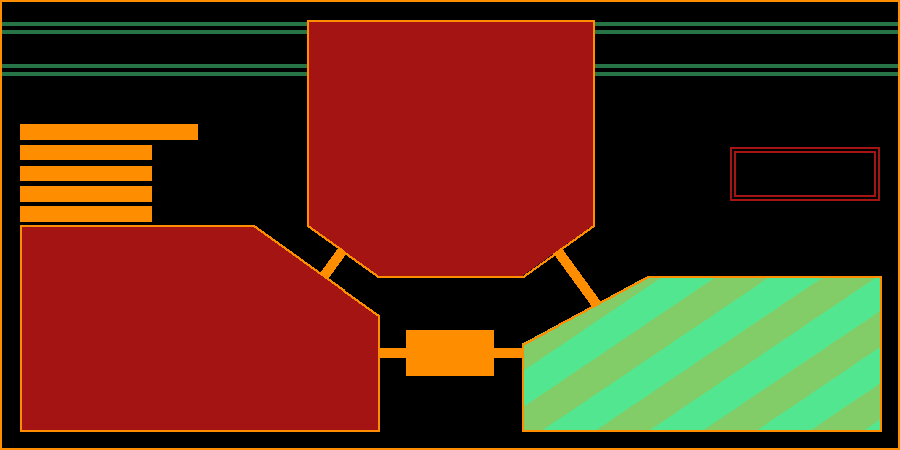

# MAGI-EVA

**由 Jev 决策模型驱动的 EVA 风格 MAGI 三贤人决策系统（Android）**

> MAGI は NERV の中枢を担う三台のスーパーコンピュータ。
> 赤木直子の人格を三つに分け、それぞれが独立に判断し、多数決と一票否決で結論を出す。

你把一个命题交给 MAGI，三台超级电脑各自用自己的「人格」审一遍，然后投票：

| | 子系统 | 移植的人格 |
|---|---|---|
| ① | **MELCHIOR • 1** | 赤木直子身为**科学家**的人格 |
| ② | **BALTHASAR • 2** | 身为**母亲**的人格 |
| ③ | **CASPER • 3** | 身为**女性**的人格 |

结论按 **誤差 → 情報 → 拒絶 → 状態 → 合意** 的固定优先级产生，其中 **拒絶 是一票否决** ——
只要有一位贤人反对，整个 MAGI 就拒绝。



*上图是 `tools/preview_panel.py` 按 `ui/MagiPanelView.java` 的布局数学渲染的，
状态用的是一次真实合议的结果：MELCHIOR 附条件（绿斜纹）、BALTHASAR 与 CASPER 否决（红），结论「拒絶」。*

---

## ⚠️ 出处与致谢（请先读这一节）

**本工程是二次开发，界面语言、合议逻辑与后端结构均非原创。** 两处上游都是 MIT 协议，
按协议要求在此显著标注，完整声明见 [`NOTICE`](NOTICE) 与 [`LICENSE`](LICENSE)。

| 被借鉴的部分 | 上游项目 | 作者 |
|---|---|---|
| **界面与合议逻辑** | [TomaszRewak/MAGI](https://github.com/TomaszRewak/MAGI) | © 2023 Tomasz Rewak |
| **后端结构** | [jev-chat/jev-chat-jarvis](https://github.com/jev-chat/jev-chat-jarvis) | © 2026 Finderchangchang and the jev-chat contributors |

三贤人块的裁形多边形、三根连接杆的 −54°/0°/+54°、配色表、闪烁动效、五个结论的判定顺序、
三段出厂人格，全部**逐值取自 TomaszRewak/MAGI**；
判断/回复/视觉三路分离的接口结构、供应商预设与端点规则、HTTP 退避与错误归一化、
密钥逐级回退，均**与 Jev 聊天助手一致**。

推荐署名写法：**基于 Jev 聊天助手（https://github.com/jev-chat/jev-chat-jarvis）二次开发。**

本作与上述原作者**无从属或背书关系**。app 内「接口 → 關於 / 授權 / 致謝」可查看同样内容。

**非官方同人作品。**《新世纪福音战士》及其全部设定、名称、术语（MAGI / NERV /
MELCHIOR / BALTHASAR / CASPER 等）版权归 khara 及权利人所有。本项目不含任何原作素材
（无动画帧、无音频、无官方图像），与权利人无任何关联。

字体 **FOT-Matisse Pro ExtraBold** 版权归 Fontworks Inc. 所有，**商用请自行取得授权**；
删掉 `assets/fonts/MatisseEB.otf` 即可回退系统字体。

---

## 这是什么，不是什么

**是**：一台把语言模型当决策单元用的 MAGI 仿真台。三个子系统各持一段可改写的人格提示词，
各自向 Jev 索取结构化裁决，控制台按 EVA 的原始界面语言把结果打出来。

**不是**：聊天客户端。这里没有对话历史、没有角色扮演。你输入的是一条**命题**，
拿回的是一组**可核对的数字**。

---

## 核心设计：为什么用 Jev，而不是让模型自由作答

这是本作与「每个子系统问一遍大模型、再把它的散文归类成是/否」那类实现最本质的区别。

传统做法要两步：先让模型**作答**，再让另一个调用**归类**那一段散文。中间那一步必然丢信息 ——
模型原本的犹豫程度、它在两个选项间的摇摆，全都在「转述」里蒸发了。

MAGI-EVA 用 Jev 的决策协议把这两步合成一步。Jev 只回答三类结构化题目：

| 题型 | 用途 | 回报 |
|---|---|---|
| `noul` | 闸门：这命题是否可被 yes/no 裁决 | true 的概率 |
| `choice` | 贤人裁决 | 选择 + **完整概率分布** + confidence |
| `score` | 确信度 | 原始分 + confidence + 分档判据 |

于是机器报出来的是**模型自己的数**，不是客户端对模型的再解释。

### 一次真实的合议记录

下面是 `tools/jvmtest/run.sh` 的输出——它跑的是**将打进 APK 的那几个类本身**
（只把 `Prefs` 依赖的 `android.content.Context/SharedPreferences` 换成内存替身），
打的是真实的 Jev 接口。询问「**我們應該啟動人類補完計劃嗎？**」，
走 OpenRouter · `typesafe/jev-1.13`：

```
[GATE] is_yes_no=0.96  is_decision=0.97  1462ms
[CASPER • 3]    verdict=no           conf=0.47  certainty=3.32  1458ms  1197tok  $0.000048
        probs {no=0.64, conditional=0.35, yes=0.01}
[BALTHASAR • 2] verdict=no           conf=0.81  certainty=5.88  1657ms  1224tok  $0.000049
        probs {no=0.87, conditional=0.13, yes=0.00}
[MELCHIOR • 1]  verdict=conditional  conf=0.51  certainty=2.67  1759ms  1210tok  $0.000049
        probs {no=0.33, conditional=0.67, yes=0.00}

---- 合議 ----
 三賢人: conditional | no | no
 閘門  : isYesNo=true
 結論  : 拒 絶  (NO)        最少一位贤人行使了否决权
 總計  : 1785ms  $0.000173  4329 tokens
```

值得一读的地方：**科学家是唯一没有直接否决的那一位**，但他给的把握度只有 0.47、
确信度 2.67/9 —— 他自己也不太站得住；而母亲（0.81 / 5.88）与女性（0.47 / 3.32）
都干净地拒绝了。三个子系统对同一条命题的分歧是真实的，这正是人格设定在起作用，
而不是三个模型在互相附和。

另注意 `總計 1785ms`：四位贤人/闸门是**并行发出**的，所以总耗时就等于最慢的那一路
（1759ms），而**不是四者相加**（5.3s）。这正是设计里强调的那一点。

⚠️ 耗时随网络波动较大，别把它当基准数据：同一命题复测时遇到过 CASPER 单路耗时 7144ms 的一次，
那一次 `總計` 就是 7176ms —— 结论（拒絶）与三个概率分布完全一致，只有耗时变了。
**并行是把总耗时压到「最慢一路」，不是压到「平均值」**；只要有一路慢，整局就跟着慢。

### 五条结论路径的实测覆盖

| 路径 | 触发条件 | 实测 |
| --- | --- | --- |
| **拒絶** | 至少一贤人反对 | ✅ 见上（conditional \| no \| no） |
| **状態** | 至少一贤人附条件同意 | ✅ 「保護第三新東京市的孩子們」→ conditional \| yes \| yes |
| **情報** | 命题不属于 yes/no 类 | ✅ 「請描述第三新東京市的防禦體系…」→ 闸门 0.05，三贤人即使两个说 yes 也一律记 情报 |
| **誤差** | 有贤人未能裁决 | ✅ 打入无效密钥 → HTTP 401 原样上抛，802ms 内快速失败（4xx 不重试） |
| **合意** | 三贤人一致无条件同意 | ⚠️ 未能自然复现（需三者同时无条件接受，本就是这个系统最罕见的结果）；该分支由 `MagiLogic.vote()` 的自洽性断言覆盖 |

`tools/smoke_test.py` 是一条**独立实现**（Python），请求体与 Android 端逐字一致；
两条路径都跑通，才说明对 Jev 协议的理解没有跑偏。

---

## 界面

三贤人面板全部**自绘 Canvas**，几何与配色逐值取自参考实现，没有一处是「感觉像」：

- 三个互锁的贤人块，块形用参考实现的三个裁形多边形（MELCHIOR / BALTHASAR / CASPER）；
- 三根连接杆分别旋转 **−54° / 0° / +54°**；
- 配色：主橙 `#FF8D00`、斜纹暗橙 `#140B02`、页眉横线 `#277547`、
  合意 `#52E691`、拒絶 `#A41413`、情報 `#3CAEE0`、状態 `#82CD68`、誤差 `gray`；
- **状態用 56° 双色绿斜纹填充，誤差用纯黑** —— 这两个状态不是纯色块；
- 等待期间面板 0.25s `step-end` 闪烁，不伪造进度条；
- 字体：**FOT-Matisse Pro ExtraBold**（EVA 标题正体），终端读数用等宽字体。

点任意贤人块 → 展开它的完整读数：裁决、逐项概率条、确信度、以及这次调用的
latency / tokens / 费用。

面板下方是**遥测台**，把 Jev 直接回报的数字全部摆出来：概率分布条、把握度、
确信度条、tokens、美元成本。这些数字没有任何一项是客户端算出来的。

---

## 后端：与参考项目同构的分路结构

后台部分按 `jev-chat-jarvis` 的结构实现，**判断 / 回复 / 视觉三路分离**，
每路各有地址、密钥、模型，密钥留空时按 `视觉 → 回复 → 判断` 逐级回退。

| 供应商预设 | 服务地址 | 模型 | 路径 |
|---|---|---|---|
| OpenRouter（默认） | `https://openrouter.ai/api` | `typesafe/jev-1.13` | `/alpha/decisions` |
| 博查 Jev | `https://jev.bocha.cn` | `bocha-jev-v1` | `/v1/systemone` |
| TypeSafe 直连 | `https://api.typesafe.ai` | `jev-latest` | `/v1/systemone` |
| Vercel AI Gateway | `https://ai-gateway.vercel.sh/typesafe` | `typesafe-ai/jev` | `/v1/systemone` |
| OpenCode Zen | `https://opencode.ai/zen` | `jev-1.13` | `/v1/systemone` |
| 自定义 | 由你填完整 URL | — | — |

密钥只写进 app 私有 `SharedPreferences`，不进日志、不进版本库；
日志里只允许出现密钥**长度**。设置页支持「從文件導入密鑰」——
读一个文本文件的第一行当密钥，若文件里有 `http(s)://` 开头的行则一并当作服务地址。

---

## 三个人格可改

「三賢人」页里 MELCHIOR / BALTHASAR / CASPER 三段提示词都可以直接改写。
改写后的文字会同时进入 Jev 的 `state.persona` 与裁决题目的 `instructions`，
因此它**真的会改变裁决结果**，不是装饰性的角色设定。清空即恢复出厂人格。

---

## 构建

### 方式一：免 Gradle 直构（推荐，本仓库的主路径）

`build.sh` 直接走 Android SDK 自带的 build-tools，跳过 Gradle：

```
aapt2 compile → aapt2 link → javac → d8 → zipalign → apksigner
```

因为整个 app 不依赖 AndroidX / Material / Kotlin，**没有任何 Maven 解析步骤**，
所以这条链路完全离线、完全确定。

```bash
bash build.sh            # 产出 build/MAGI-EVA-debug.apk
bash build.sh release    # release 变体
bash build.sh clean
```

需要：**JDK 17+**、**Android SDK（platform 34 + build-tools 36.0.0）**、**python 3**（第 5 步用它把 classes.dex 写进 APK）。

脚本**不写死任何本机路径**，按这个顺序自动解析：`PROJ` = 脚本所在目录，
`SDK` = `$ANDROID_HOME` → `$ANDROID_SDK_ROOT` → 默认安装位置，
`JAVA_BIN` = `$JAVA_HOME/bin` → `PATH` 上的 `java`。要覆盖就用环境变量：

```bash
ANDROID_HOME=/opt/android-sdk BUILD_TOOLS=35.0.0 bash build.sh
```

> 为什么是 build-tools **36**：34.0.0 自带的 R8 8.2.2 遇到 enum 类会内部崩溃
> （`NullPointerException: Cannot invoke "String.length()"`）。36.0.0 的 d8 对同一批 class 正常。
> 另外 `d8.bat` / `apksigner.bat` 在 SDK 路径含空格时会炸，所以脚本一律用
> `java -cp lib/d8.jar` 与 `java -jar lib/apksigner.jar` 直调。

### 方式二：Gradle / Android Studio

仓库同时是一份标准的 AGP 工程，直接 `File → Open` 即可：

```bash
./gradlew assembleDebug
```

`app/src/main/AndroidManifest.xml` 刻意**不写** `package="…"`
（AGP 8 起该属性被禁止，改用 `build.gradle.kts` 的 `namespace`）；
`build.sh` 会在构建目录里生成一份注入 `package` 的副本，源文件始终保持两边兼容。

### 安装

预编译包在 [`dist/`](dist/)（也可从 Releases 下载）：

```bash
adb install -r dist/MAGI-EVA-1.0.0.apk
```

它由 `build.sh release` 产出，用脚本自动生成的**自签名开发密钥**签名（`build/magi-debug.jks`，
口令写在 `build.sh` 里）。要做正式发布请换成自己的密钥：

```bash
MAGI_KEYSTORE=/path/to/my.jks MAGI_KEY_ALIAS=mykey MAGI_KEY_PASS=*** bash build.sh release
```

打开 app →「接口」→ 填入判断接口的 API Key（用你已有的那把即可，回复/视觉留空会自动继承）
→ 回到主界面输入命题 →「執 行」。

**小贴士**：如果设备在受限网络里，而你的密钥服务商需要代理才能访问，
app 本身不走系统代理 —— 请让设备网络本身可直连，或在设置页把服务地址换成可直连的等价端点。

---

## 目录

```
app/src/main/java/com/nerv/magi/
  MainActivity.java        主控台：三贤人面板 + 遥测 + 询问输入
  SettingsActivity.java    接口配置：判断/回复/视觉三路 + 连通测试 + 密钥导入
  PersonaActivity.java     三贤人人格配置
  core/
    Prefs.java             配置存储（三路 + 三个人格，密钥逐级回退）
    MagiModels.java        数据模型（Choice / Score / Usage / Gate / UnitReading / Session）
    MagiLogic.java         合议逻辑：一票否决制
  jev/
    HttpJson.java          POST-JSON + 429/529 退避 + 统一异常
    ApiException.java      带路由与状态码的失败
    JevQuestions.java      MAGI 题目集（noul / choice / score）
    JudgeClient.java       判断路
    ReplyClient.java       回复路（可选判词）
    VisionClient.java      视觉路
    MagiClient.java        门面：四路并行 → 合议
  ui/
    MagiPanelView.java     三贤人面板（自绘 Canvas）
    TelemetryView.java     遥测台（概率条 / 确信度条 / tokens / 费用）
    UnitModal.java         单贤人完整读数弹窗
    Ui.java                配色与字体常量
tools/smoke_test.py        独立冒烟测试（Python，与 Android 端请求体逐字一致）
tools/jvmtest/             JVM 端到端测试：跑真实的 core/ + jev/ 代码
tools/preview_panel.py     面板几何预览（纯标准库渲染 PNG，用于核对布局）
docs/BACKGROUND.md         MAGI 的背景考
docs/DESIGN.md             视觉规格
docs/images/               文档配图（由 tools/preview_panel.py 生成）
dist/                      预编译 APK
NOTICE                     出处与致谢（含上游 MIT 声明）
LICENSE                    MIT
```

## 本工程做过哪些验证

| 验证 | 手段 | 结果 |
| --- | --- | --- |
| 能编译 | `javac` 全量 + `d8` | 78 个 class → classes.dex 100,336 bytes |
| 能打包 | `aapt2` → `d8` → `zipalign` → `apksigner` | 6,406,947 bytes，v2 + v3 签名校验通过 |
| 清单正确 | `aapt2 dump badging` | `com.nerv.magi`，launcher = `MainActivity`，minSdk 24 / target 34 |
| 代码真进包了 | 解包核对 APK 条目 | `classes.dex`、`assets/fonts/MatisseEB.otf`、`resources.arsc` 均在 |
| **后端跑得对** | `tools/jvmtest`（真实类 + 内存替身，打真实接口） | 四条结论路径实测通过，见上表 |
| 协议没理解错 | `tools/smoke_test.py`（独立 Python 实现） | 与 Java 端结论一致 |
| 面板几何正确 | `tools/preview_panel.py` 渲染 PNG | 与参考实现自带截图逐块比对一致 |

**没做过的**：没有在真机或模拟器上装起来跑过——本机没有任何 AVD、system image 或已连接设备。
所以「能安装、能启动、能显示」这一步是**由上面这些静态与端到端证据间接支撑的，而不是实测的**。
拿到机器后第一件事应是 `adb install -r build/MAGI-EVA-debug.apk` 跑一遍。

`tools/smoke_test.py` 的请求体与 Android 端 `JevQuestions.java` 保持**逐字一致**，
所以脚本跑通就等于 Java 实现的设计是对的；改任何一处都要两边同改。

---

## 已知限制

- **没有本地缓存**：每次合议都是一次真实的接口调用。三贤人并行发出，
  总耗时 ≈ 最慢的一路（实测 ~1.5–5s），费用量级在 `$0.0002` 一次。
- **不是 yes/no 的命题拿不到合意/拒絶**：这是 MAGI 的正典行为，一律降级为「情報」。
- **闸门失败会被判为誤差**：一个不是 yes/no 的命题若恰有贤人报错，结论仍是誤差而非情報 ——
  判定顺序与参考实现一致，是刻意的。
- **判词（叙述）默认关闭**：它走生成路，会把耗时与费用翻倍，而裁决本身不需要它。
- **视觉路未接入主流程**：保留完整实现与连通测试，供日后扩展「对着屏幕询问 MAGI」。

---

## 参考与致谢

- **[TomaszRewak/MAGI](https://github.com/TomaszRewak/MAGI)** —— 界面与合议逻辑的参考实现。
  三个裁形多边形、三根连接杆的旋转角、配色表、闪烁动效、五个结论的判定顺序、
  以及三段出厂人格，全部取自该项目。`Copyright (c) 2023 Tomasz Rewak`，MIT。
- **[jev-chat/jev-chat-jarvis](https://github.com/jev-chat/jev-chat-jarvis)** —— 后台结构参考。
  三路分离的接口配置、供应商预设与端点规则、`HttpJson` 的退避与错误归一化、
  密钥逐级回退策略，均与该项目的实现保持一致。
  `Copyright (c) 2026 Finderchangchang and the jev-chat contributors`，MIT。
- **Jev** —— 本作使用的决策模型（默认 `typesafe/jev-1.13`，经 OpenRouter 调用）。
- **FOT-Matisse Pro ExtraBold** —— EVA 标题使用的正体字，随包内置；
  版权归 Fontworks Inc.，**商用需自行取得授权**。

《新世纪福音战士》及其全部设定、名称、术语的版权归 khara 及权利人所有。
本项目是非官方同人作品，与权利人无任何关联，且不含任何原作素材。

上游 MIT 协议的完整声明与逐项借用清单见 [`NOTICE`](NOTICE)。

## 许可

MIT，见 [`LICENSE`](LICENSE)。`Copyright (c) 2026 Fantasality`

分发或再分发时请保留 `LICENSE` 与 `NOTICE`——后者是上游协议的要求，不是可选项。
